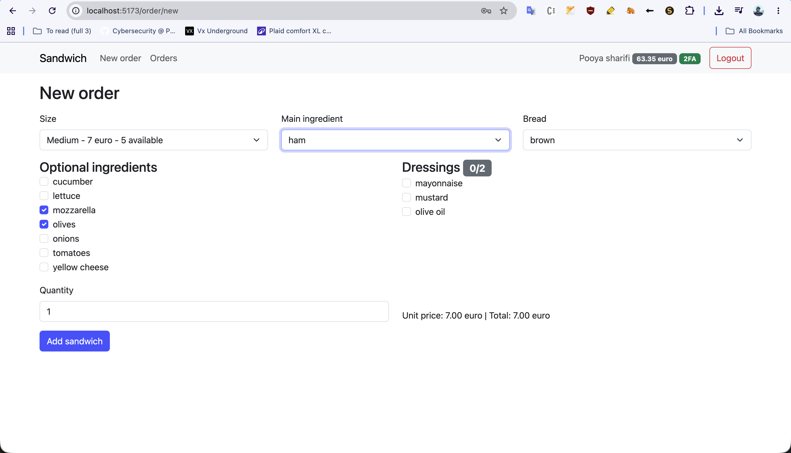
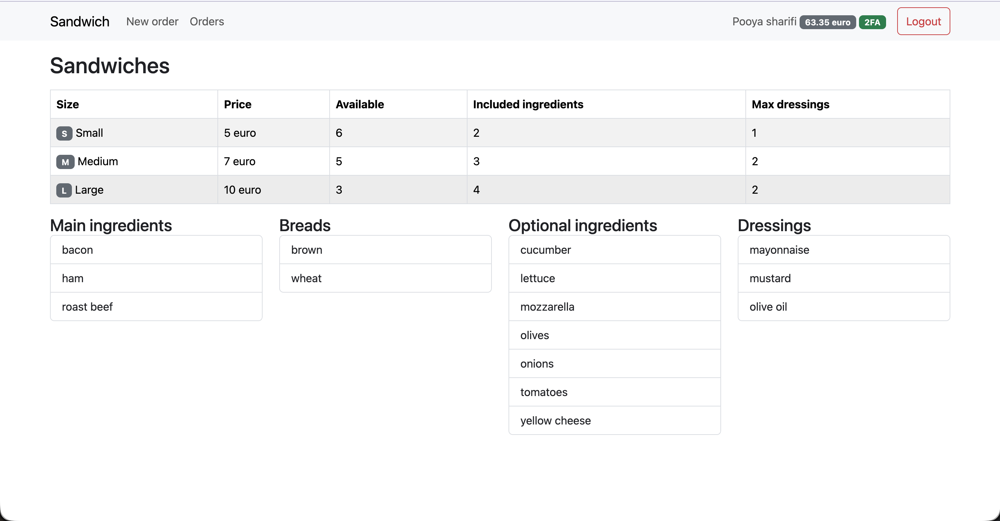
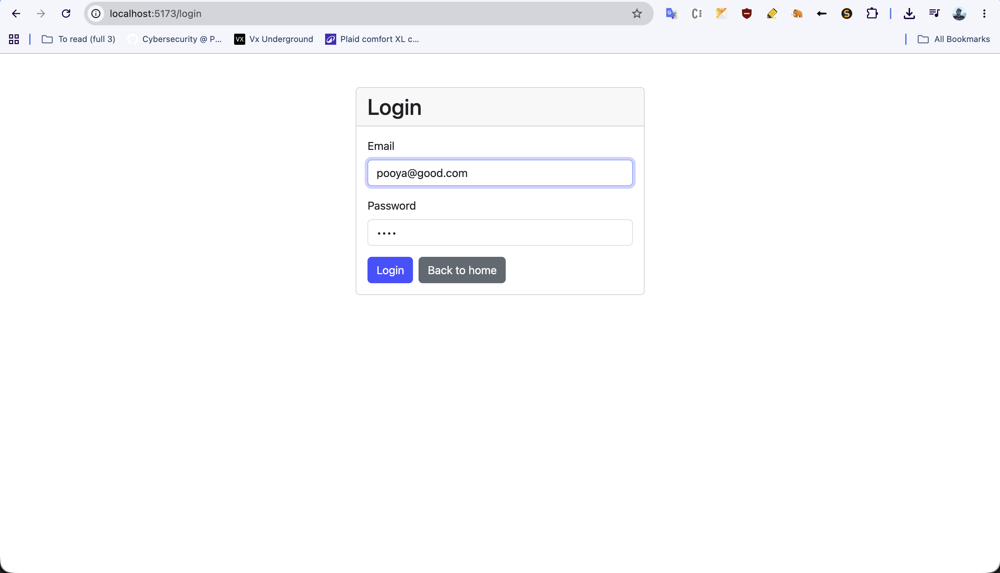
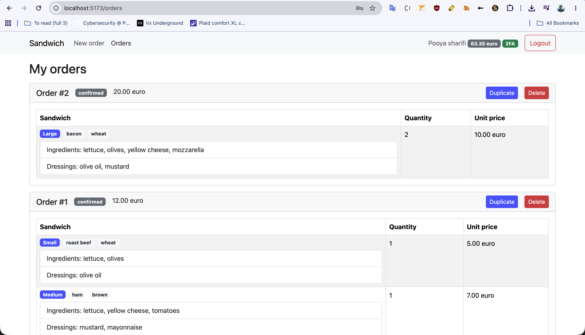
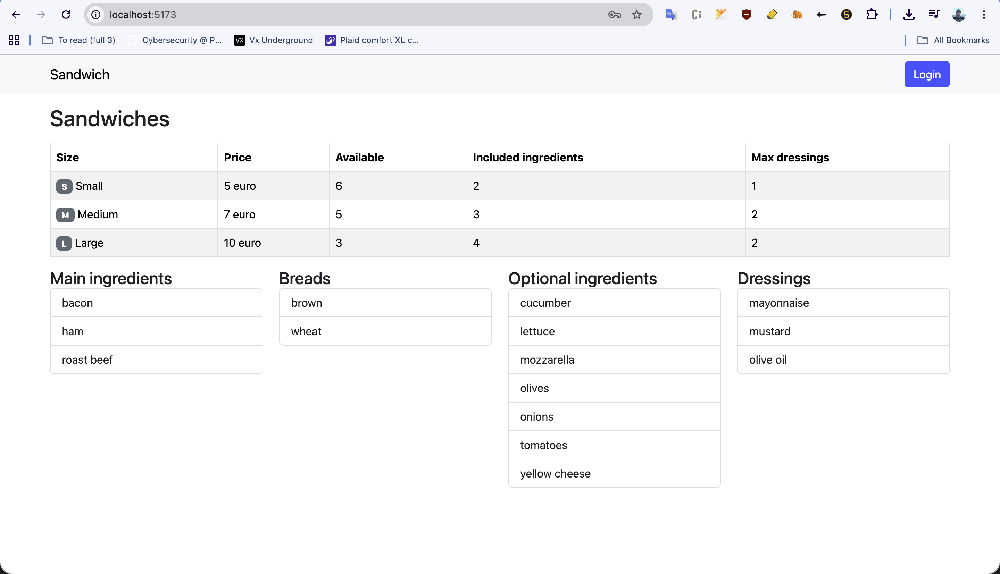

# Sandwich Ordering App

A full-stack web app for ordering custom sandwiches from a restaurant. Customers browse the menu, build sandwiches, manage a cart and place orders paid from their account credit. Deleting an order requires two-factor authentication.

Built with **React 19 + Vite** on the client, **Node.js + Express 5** on the server, and **SQLite** for storage. Developed as the final project of the *Web Applications* course at Politecnico di Torino (grade **30/30**).



## Features

- **Public menu:** sandwich sizes, prices, today's remaining availability, and every ingredient, bread and dressing.
- **Sandwich configurator:** choose size, bread, main ingredient, optional ingredients and dressings, within the rules of each size.
- **Cart:** edit quantities, remove items, and get a 20% discount on 4 or more sandwiches.
- **Orders:** checked on the server against daily availability and the user's credit, then saved in one request.
- **Order history:** duplicate a past order into a new cart, or cancel it for a 90% refund. Cancelling restores availability.
- **Authentication:** session login with scrypt-hashed, salted passwords (Passport.js).
- **Two-factor authentication (TOTP):** required to cancel an order, with protection against reusing the same code.
- **Validation:** every API input is validated with express-validator; the server never trusts prices or limits sent by the client.

## Tech stack

| Layer | Technologies |
|---|---|
| Client | React 19, React Router 7, React Bootstrap, Vite |
| Server | Node.js, Express 5, Passport.js (local strategy), express-session, express-validator, otpauth |
| Database | SQLite |

## Getting started

Requires Node.js 20 or newer.

```bash
# 1. Start the API server (http://localhost:3001)
cd server
npm install
npm start

# 2. In another terminal, start the client (http://localhost:5173)
cd client
npm install
npm run dev
```

Optional environment variables for the server:

| Variable | Default | Purpose |
|---|---|---|
| `SESSION_SECRET` | a development-only value | Secret used to sign session cookies. Set your own outside local development. |
| `PORT` | `3001` | Port of the API server |

The SQLite database (`server/sandwich.db`) comes pre-filled with demo data. The `*_init.sql` files in `server/` recreate it from scratch.

### Demo accounts

All demo accounts use the password `1234`:

- `pooya@good.com`
- `sina@d.com`
- `peyman@s.com`
- `nastaran@test.com`

To try two-factor authentication, add this demo TOTP secret to an authenticator app: `LXBSMDTMSP2I5XFXIYRGFVWSFI`.

## Project structure

```
client/   React app: pages/, components/, API.js (calls to the server), contexts.js
server/   Express API: index.mjs (setup), api.mjs (routes), dao-*.mjs (database access)
img/      Screenshots
```

## Screenshots

| | |
|---|---|
|  |  |
|  |  |
|  |  |

## API reference

- GET `/api/sandwich-options`
  - response body: list of sandwich sizes with current availability, main ingredients, breads, optional ingredients and dressings. Example:

```
{
  "sizes": [
    { "id": "S", "name": "Small", "price": 5, "dailyLimit": 10, "includedIngredients": 2, "maxDressings": 1, "available": 5 }
  ],
  "mainIngredients": [ { "id": 1, "name": "roast beef" } ],
  "breads": [ { "id": 1, "name": "wheat" } ],
  "optionalIngredients": [ { "id": 1, "name": "lettuce" } ],
  "dressings": [ { "id": 1, "name": "olive oil" } ]
}
```

- GET `/api/orders` (Authenticated)
  - response body: list of confirmed orders of the authenticated user, including ids needed to duplicate an order into a draft cart. Example:

```
[
  {
    "id": 1,
    "userId": 1,
    "totalPrice": 12,
    "status": "confirmed",
    "sandwiches": [
      {
        "id": 1,
        "orderId": 1,
        "sizeId": "S",
        "mainIngredientId": 1,
        "breadId": 1,
        "quantity": 1,
        "unitPrice": 5,
        "size": "Small",
        "sizePrice": 5,
        "includedIngredients": 2,
        "maxDressings": 1,
        "mainIngredient": "roast beef",
        "bread": "wheat",
        "ingredients": [ { "id": 1, "name": "lettuce" } ],
        "dressings": [ { "id": 1, "name": "olive oil" } ]
      }
    ]
  }
]
```

- POST `/api/orders` (Authenticated)
  - request body: list of sandwiches to be ordered:

```
{
  "sandwiches": [
    {
      "sizeId": "S",
      "mainIngredientId": 1,
      "breadId": 1,
      "ingredientIds": [1, 2],
      "dressingIds": [1],
      "quantity": 1
    }
  ]
}
```

- response body: ok `{ "id": 7, "totalPrice": 5 }` or not: `{ "errors": [...] }`

- DELETE `/api/orders/:id` (Authenticated + TOTP)
  - response body: ok `{ "refund": 18 }` or not: `{ "error": "..." }`
  - only the owner of the order can delete it
  - the user must have TOTP enabled and must have completed TOTP authentication
  - restores sandwich availability and refunds 90% of the amount paid

* POST `/api/sessions`
* Description: Create a new session starting from given credentials.
* Request body: An object with username and password

```
{
  "username": "pooya@good.com",
  "password": "1234"
}
```

- Response: `200 OK` (success) or `401 Unauthorized` (wrong credentials) or `500 Internal Server Error` (generic error).
- Response body: An object with user information

```
{
  "id": 1,
  "username": "pooya@good.com",
  "name": "Pooya sharifi",
  "balance": 100,
  "isTotp": false
}
```

### Second factor authentication

- POST `/api/login-totp`
- Description: Complete TOTP authentication for a user already logged in with username and password.
- Request body: An object with the TOTP code

```
{
  "code": "123456"
}
```

- Response: `200 OK` (success) or `401 Unauthorized` (wrong/replayed TOTP) or `400 Bad Request` (TOTP not enabled).
- Response body:

```
{
  "otp": "authorized"
}
```

### Get the current session if existing

- GET `/api/sessions/current`
- Description: Verify if the given session is still valid and return the info about the logged-in user. A cookie with a VALID SESSION ID must be provided to get the info of the user authenticated in the current session.
- Request body: _None_
- Response: `200 OK` (success) or `401 Unauthorized` (error).
- Response body: An object with user information

```
{
  "id": 1,
  "username": "pooya@good.com",
  "name": "Pooya sharifi",
  "balance": 100,
  "isTotp": true
}
```

### Destroy the current session (logout)

- DELETE `/api/sessions/current`
- Description: Delete the current session. A cookie with a VALID SESSION ID must be provided.
- Request body: _None_
- Response: `200 OK` (success).
- Response body: `{}`

## Database Tables

- Table `users` - registered users, with hashed+salted password, per-user TOTP secret and credit
  - id, email, name, hash, salt, secret, lastTotpStep, balance
- Table `sandwich_sizes` - the three sizes with price, daily limit and per-size rules
  - id ('S'/'M'/'L'), name, price, dailyLimit, includedIngredients, maxDressings
- Table `main_ingredients` - available main ingredients
  - id, name
- Table `breads` - available bread types
  - id, name
- Table `optional_ingredients` - available optional ingredients
  - id, name
- Table `dressings` - available dressings
  - id, name
- Table `orders` - one row per order of a user
  - id, userId, totalPrice, status ('confirmed'/'cancelled')
- Table `order_sandwiches` - one row per configured sandwich in an order
  - id, orderId, sizeId, mainIngredientId, breadId, quantity, unitPrice
- Table `order_sandwich_ingredients` - optional ingredients of each ordered sandwich (many-to-many)
  - sandwichId, ingredientId
- Table `order_sandwich_dressings` - dressings of each ordered sandwich (many-to-many)
  - sandwichId, dressingId

## Main React Components

**Context** (`contexts.js`): `AuthContext` (login state, user, auth handlers) and `CartContext` (cart items, cart update handler) — provided in `App`, consumed by pages and layout.

**Pages** (in `pages/`):

- `LoginPage`: routing logic between `LoginForm`, `TotpForm`, and redirect based on auth state
- `SandwichOptionsPage`: public page listing all sandwich sizes, prices, and available ingredients
- `SandwichConfiguratorPage`: sandwich builder form, editable cart with discount display, and order submission
- `OrdersPage`: confirmed user orders list with duplicate-to-cart and TOTP-guarded delete actions

**Components** (in `components/`):

- `GenericLayout`: navbar with user name, balance, 2FA badge, "Complete 2FA" shortcut, and logout button
- `LoginForm`: email/password form with inline error, pre-filled with a default user
- `TotpForm`: 6-digit TOTP code form with inline error and skip option
- `CartTable`: draft order table with quantity controls, edit/remove actions, subtotal, 20% discount display, and confirm button
- `OrderTable`: single order card with sandwiches breakdown, duplicate and delete buttons
- `OptionList`: read-only list of sandwich options for the public page


## Author

Pooya Sharifi · [GitHub](https://github.com/POOYASP2) · [LinkedIn](https://www.linkedin.com/in/pooya-sharifi/)
