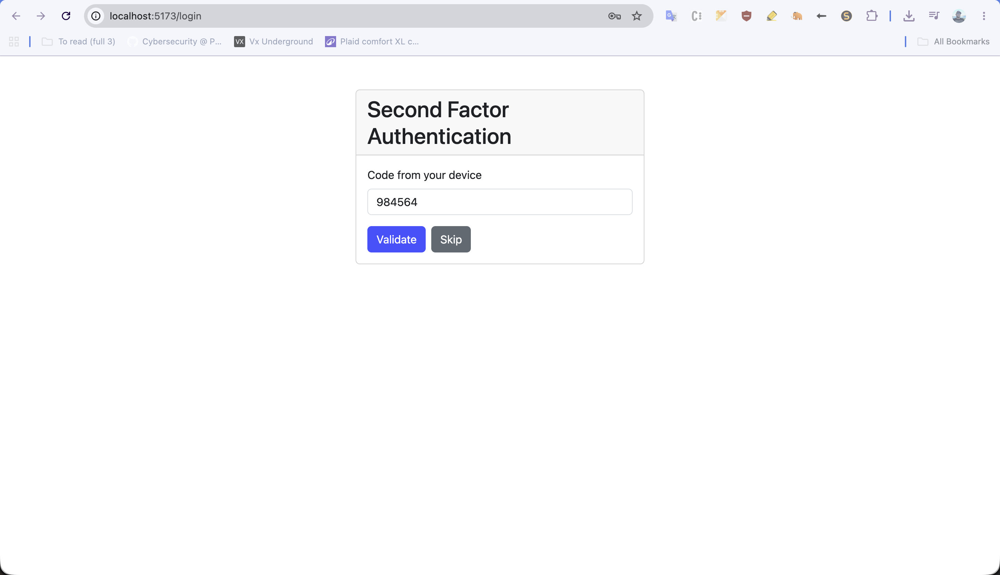
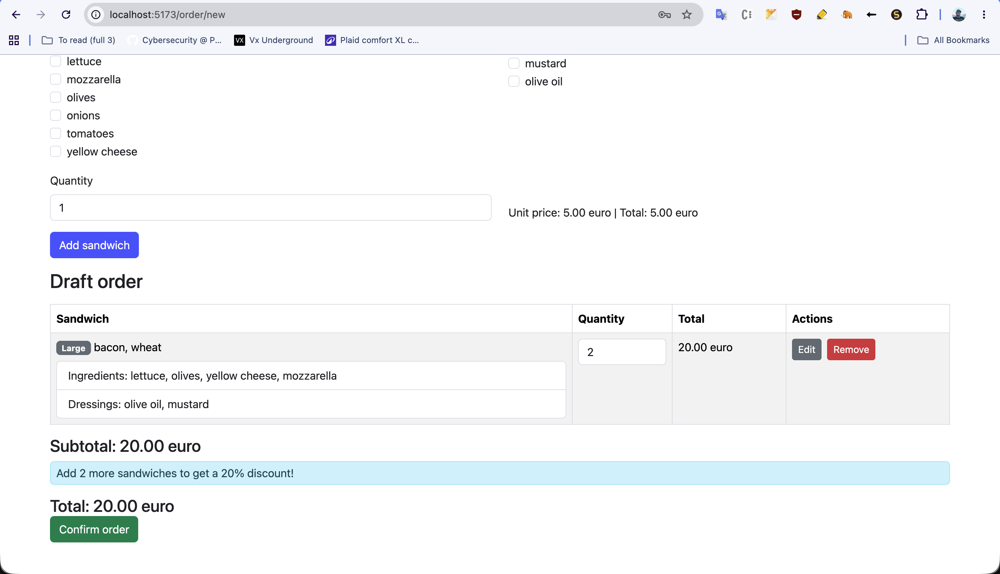

[](https://classroom.github.com/a/gRhWiR3Q)

# Exam #2: "Sandwich"

## Student: s355130 SHARIFI POOYA

## React Client Application Routes

- Route `/`: list of sandwich sizes, prices, availability and all ingredients
- Route `/login`: login with credentials / TOTP
- Route `/order/new`: sandwich configuration and cart confirmation, for logged-in users
- Route `/orders`: list of user's orders, with duplicate and delete actions

## API Server

- GET `/api/sandwich-options`
  - response body: list of sandwich sizes with current availability, main ingredients, breads, optional ingredients and dressings. Example:

```
{
  "sizes": [
    { "id": "S", "name": "Small", "price": 5, "dailyLimit": 10, "includedIngredients": 2, "maxDressings": 1, "available": 5 }
  ],
  "mainIngredients": [ { "id": 1, "name": "roast beef" } ],
  "breads": [ { "id": 1, "name": "wheat" } ],
  "optionalIngredients": [ { "id": 1, "name": "lettuce" } ],
  "dressings": [ { "id": 1, "name": "olive oil" } ]
}
```

- GET `/api/orders` (Authenticated)
  - response body: list of confirmed orders of the authenticated user, including ids needed to duplicate an order into a draft cart. Example:

```
[
  {
    "id": 1,
    "userId": 1,
    "totalPrice": 12,
    "status": "confirmed",
    "sandwiches": [
      {
        "id": 1,
        "orderId": 1,
        "sizeId": "S",
        "mainIngredientId": 1,
        "breadId": 1,
        "quantity": 1,
        "unitPrice": 5,
        "size": "Small",
        "sizePrice": 5,
        "includedIngredients": 2,
        "maxDressings": 1,
        "mainIngredient": "roast beef",
        "bread": "wheat",
        "ingredients": [ { "id": 1, "name": "lettuce" } ],
        "dressings": [ { "id": 1, "name": "olive oil" } ]
      }
    ]
  }
]
```

- POST `/api/orders` (Authenticated)
  - request body: list of sandwiches to be ordered:

```
{
  "sandwiches": [
    {
      "sizeId": "S",
      "mainIngredientId": 1,
      "breadId": 1,
      "ingredientIds": [1, 2],
      "dressingIds": [1],
      "quantity": 1
    }
  ]
}
```

- response body: ok `{ "id": 7, "totalPrice": 5 }` or not: `{ "errors": [...] }`

- DELETE `/api/orders/:id` (Authenticated + TOTP)
  - response body: ok `{ "refund": 18 }` or not: `{ "error": "..." }`
  - only the owner of the order can delete it
  - the user must have TOTP enabled and must have completed TOTP authentication
  - restores sandwich availability and refunds 90% of the amount paid

* POST `/api/sessions`
* Description: Create a new session starting from given credentials.
* Request body: An object with username and password

```
{
  "username": "pooya@good.com",
  "password": "1234"
}
```

- Response: `200 OK` (success) or `401 Unauthorized` (wrong credentials) or `500 Internal Server Error` (generic error).
- Response body: An object with user information

```
{
  "id": 1,
  "username": "pooya@good.com",
  "name": "Pooya sharifi",
  "balance": 100,
  "canDoTotp": true,
  "isTotp": false
}
```

### Second factor authentication

- POST `/api/login-totp`
- Description: Complete TOTP authentication for a user already logged in with username and password.
- Request body: An object with the TOTP code

```
{
  "code": "123456"
}
```

- Response: `200 OK` (success) or `401 Unauthorized` (wrong/replayed TOTP) or `400 Bad Request` (TOTP not enabled).
- Response body:

```
{
  "otp": "authorized"
}
```

### Get the current session if existing

- GET `/api/sessions/current`
- Description: Verify if the given session is still valid and return the info about the logged-in user. A cookie with a VALID SESSION ID must be provided to get the info of the user authenticated in the current session.
- Request body: _None_
- Response: `200 OK` (success) or `401 Unauthorized` (error).
- Response body: An object with user information

```
{
  "id": 1,
  "username": "pooya@good.com",
  "name": "Pooya sharifi",
  "balance": 100,
  "canDoTotp": true,
  "isTotp": true
}
```

### Destroy the current session (logout)

- DELETE `/api/sessions/current`
- Description: Delete the current session. A cookie with a VALID SESSION ID must be provided.
- Request body: _None_
- Response: `200 OK` (success).
- Response body: `{}`

## Database Tables

- Table `users` - registered users, with hashed+salted password, per-user TOTP secret and credit: id, email, name, hash, salt, secret, lastTotpStep, balance
- Table `sandwich_sizes` - the three sizes with price, daily limit and per-size rules: id ('S'/'M'/'L'), name, price, dailyLimit, includedIngredients, maxDressings
- Table `main_ingredients` - available main ingredients: id, name
- Table `breads` - available bread types: id, name
- Table `optional_ingredients` - available optional ingredients: id, name
- Table `dressings` - available dressings: id, name
- Table `orders` - one row per order of a user: id, userId, totalPrice, status ('confirmed'/'cancelled')
- Table `order_sandwiches` - one row per configured sandwich in an order: id, orderId, sizeId, mainIngredientId, breadId, quantity, unitPrice
- Table `order_sandwich_ingredients` - optional ingredients of each ordered sandwich (many-to-many): sandwichId, ingredientId
- Table `order_sandwich_dressings` - dressings of each ordered sandwich (many-to-many): sandwichId, dressingId

## Main React Components

**Context** (`contexts.js`): `AuthContext` (login state, user, auth handlers) and `CartContext` (cart items, cart update handler) — provided in `App`, consumed by pages and layout.

**Pages** (in `pages/`):

- `LoginPage`: routing logic between `LoginForm`, `TotpForm`, and redirect based on auth state
- `SandwichOptionsPage`: public page listing all sandwich sizes, prices, and available ingredients
- `SandwichConfiguratorPage`: sandwich builder form, editable cart with discount display, and order submission
- `OrdersPage`: confirmed user orders list with duplicate-to-cart and TOTP-guarded delete actions

**Components** (in `components/`):

- `GenericLayout`: navbar with user name, balance, 2FA badge, "Complete 2FA" shortcut, and logout button
- `LoginForm`: email/password form with inline error, pre-filled with a default user
- `TotpForm`: 6-digit TOTP code form with inline error and skip option
- `CartTable`: draft order table with quantity controls, edit/remove actions, subtotal, 20% discount display, and confirm button
- `OrderTable`: single order card with sandwiches breakdown, duplicate and delete buttons
- `OptionList`: read-only list of sandwich options for the public page

(only _main_ components, minor ones may be skipped)

## Screenshot

Order creation page:


Other pages:







## Users Credentials

- `pooya@good.com`, password `1234`, TOTP enabled
- `sina@d.com`, password `1234`, TOTP enabled
- `peyman@s.com`, password `1234`, TOTP not enabled
- `nastaran@test.com`, password `1234`, TOTP not enabled
